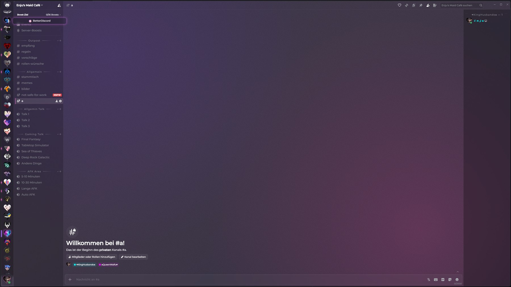
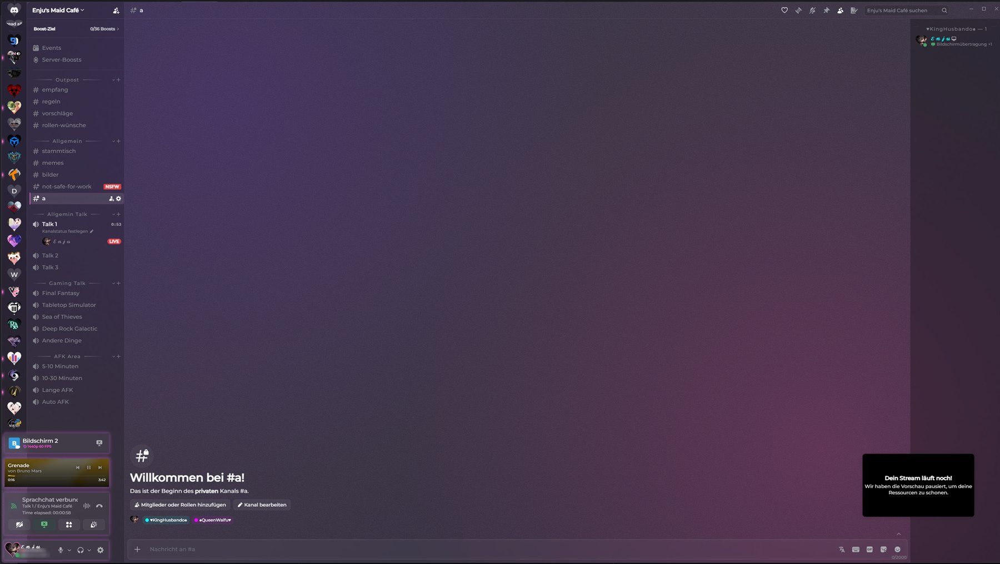
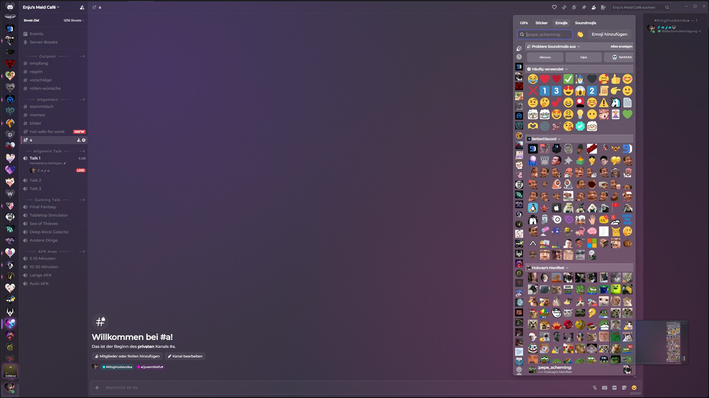
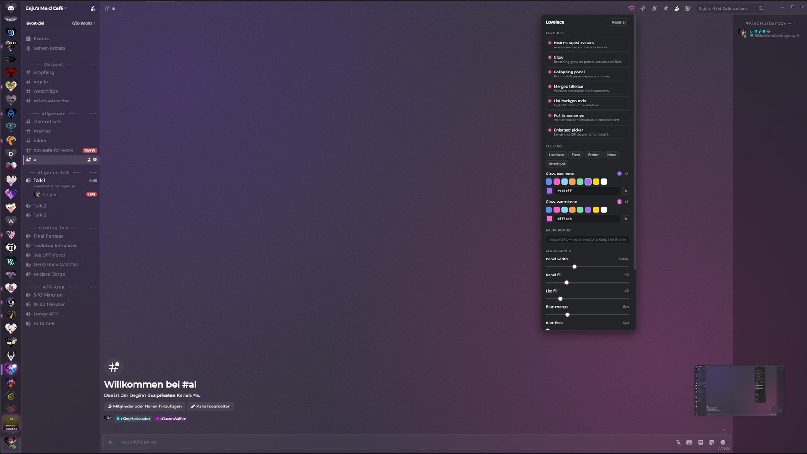
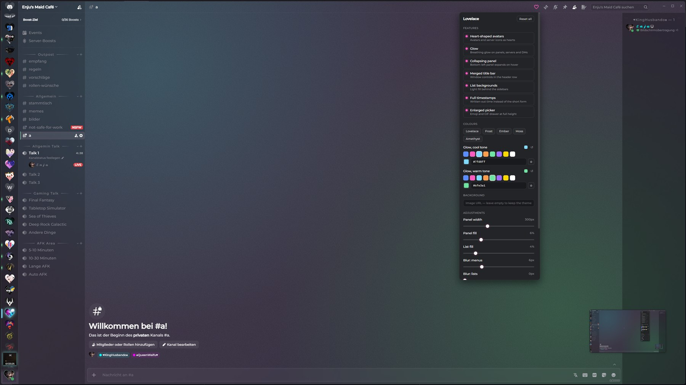

# Lovelace


A clear glass theme for Discord: blurred, translucent columns over a background
image, a heart on your own avatar and the open server, a collapsible panel in
the bottom left, and a blue-pink glow that appears when something happens.

> **Settings without editing CSS:**
> [LovelaceSettings](https://github.com/Enjuchan/LovelaceSettings) adds a
> toolbar button with switches for every feature, colour pickers for the glow
> and sliders for blur, opacity and panel width. Optional - the theme works on
> its own, and everything it sets can also be written by hand.

> **Works best with [DynamicBackgrounds](https://github.com/Enjuchan/DynamicBackgrounds)**,
> a companion plugin that manages your background images with slideshows,
> transitions and ambient effects. The two are built to work together: while
> the plugin is enabled, the theme hands the background layer over to it
> completely.

---

## Screenshots



The bottom-left panel expanded on hover, with the voice controls, the stream
panel and the Spotify player:



The emoji picker stretched to the full height of the window:



The glow is two colours in one place, so a change carries through the whole
client. The same view with the default palette and with the Moss preset, set
through [LovelaceSettings](https://github.com/Enjuchan/LovelaceSettings):





---

## Features

### Clear glass

The server rail, the channel and DM list and the member list are clear glass:
a strong blur with boosted colour, only a faint dark tint, and a fine light
edge between the columns. The rail sits one step darker than the lists, so the
columns stay apart without gaps. The chat is a calmer, darker surface without
blur, so text stays readable over bright images. Context menus, tooltips,
modals, the settings window, the call view, pinned messages and profile popouts
keep their translucent backdrop.

### Hearts where they mean something

Your own avatar in the account panel and the icon of the server you have open
are hearts. Everything else keeps Discord's shapes, so the heart marks "you"
and "here". The outline is a scalable polygon in a single variable, so it can
be swapped for any other shape.

### Collapsible bottom-left panel

The account area stays at 56×56 and expands on hover to reveal the stream
panel, voice controls and - with the SpotifyControls plugin - the music player.
The panels slide in with opacity and transform only, so no layout work happens
during the animation and the motion stays smooth.

### Reactive glow

Glow means something is happening: hover, the selected server, the active DM,
someone speaking in voice. At rest nothing glows and nothing moves, except your
own avatar, which stays lit as an anchor. Two colours, blue and pink, defined
in one place.

### Enlarged emoji and GIF picker

The picker drawer is stretched to the full height of the window instead of
Discord's default short panel, so noticeably more emoji, GIFs and stickers fit
on screen without scrolling.

### Cleaned-up interface

- The separate title bar row is gone. Minimise, maximise and close move down
  into the header row alongside the search field and toolbar buttons,
  reclaiming a full row of vertical space. The header takes over as the window
  drag area, so the window still moves normally, and every control in it stays
  clickable.
- Back and forward arrows and the divider before the window buttons are gone.
- Shop, Nitro and Quests are hidden from the DM list. Message requests and
  everything else stay where they are.
- The gift button is removed from the message bar.

### Message list

Mentions in the theme's colours instead of Discord's yellow - a gradient fading
out to the right, so the text stays readable, with the bar on the left
recoloured to match. The colours are mixed from your glow setting, so they
follow it when you change it.

Hovering a message gives a faint sheen with a light edge rather than a grey
box, and embeds pick up the frosted glass instead of sitting there as plain
blocks. The coloured stripe on an embed stays - Discord sets it per embed, so
it carries information.

### Details

- Full timestamps on every message instead of Discord's short form
- Gold gradient on progress bars
- Speaking indicator as a glowing ring rather than a flat outline
- Montserrat as the interface font

---

## Installation

1. Install [BetterDiscord](https://betterdiscord.app)
2. Download `Lovelace.theme.css`
3. Put it in your BetterDiscord themes folder
   - Windows: `%appdata%\BetterDiscord\themes`
   - macOS: `~/Library/Application Support/BetterDiscord/themes`
   - Linux: `~/.config/BetterDiscord/themes`
4. Enable the theme in Discord under Settings → Themes

### Staying up to date

A theme is plain CSS and executes no code, so it cannot check for its own
updates. [LovelaceSettings](https://github.com/Enjuchan/LovelaceSettings) does
it on the theme's behalf: with the plugin installed, a notice appears whenever a
newer version of Lovelace is released, and one click installs it.

Without the plugin, updating means downloading the file again by hand. Watching
the repository on GitHub is the other way to hear about new releases.

---

## Background

The theme ships with a background image. To use your own, override one variable
in your Custom CSS - the theme file itself stays untouched:

```css
:root { --bg-image: url("https://your-image-url"); }
```

The image is dimmed and blurred by default, so text stays readable and the
motif works as atmosphere rather than competing for attention. Both are
adjustable:

```css
:root {
  --brightness-bg-image: 1;   /* 1 = undimmed */
  --bg-blur: 0px;             /* 0px = sharp */
}
```

The background sits on Discord's own background layer rather than on `body`,
because `body` is behind the entire app and stays hidden whenever an app layer
is opaque.

For a managed library with slideshows, transitions and ambient effects, the
theme pairs with
[DynamicBackgrounds](https://github.com/Enjuchan/DynamicBackgrounds). While the
plugin is enabled the theme's own background steps aside completely, so the
plugin's transitions, ambient effects, blur and dimming all work as intended.

Leave the plugin's **Override theme CSS variable** setting switched off - the
theme does not need it, and with it enabled the plugin only hands over an image
URL instead of showing its own layer, which disables its effects.

---

## Optional: Spotify

If the BetterDiscord plugin **SpotifyControls** is installed, the player in the
bottom-left panel is restyled: the album art is pulled across the whole player
as a blurred, dimmed backdrop with the track details and controls layered on
top. Hovering brings the artwork into focus.

Without the plugin those elements do not exist and the rules simply never
apply - nothing else changes.

| Variable | What it does |
| --- | --- |
| `--spotify-cover-blur` | How soft the album art sits behind the controls |
| `--spotify-cover-brightness` | How far it is dimmed, `1` = undimmed |

---

## Customising

All adjustable values sit in the `:root` block near the top of the file.

| Variable | What it does |
| --- | --- |
| `--bg-image` | The background image |
| `--bg-base` | Colour shown while the image loads |
| `--brightness-bg-image` | Dims the background, `1` = unchanged |
| `--bg-blur` | Blurs the background, `0px` = sharp |
| `--panel-collapsed` / `--panel-expanded` | Width of the bottom-left panel, collapsed and expanded |
| `--panel-reserve` | Gap between the sidebar lists and the panel |
| `--panel-fade` | Length of the soft fade at the bottom of those lists |
| `--panel-color` | Fill of the glass panels |
| `--blur-other` | Backdrop blur on panels and windows |
| `--blur-popup` | Backdrop blur on menus, tooltips and popouts |
| `--glow-blue` / `--glow-pink` | Glow colours, `-soft` variants for the resting state |
| `--heart-clip` | The heart polygon - replace it to change the avatar shape |
| `--titlebar-height` | Height of the window controls in the header row |
| `--winbuttons-space` | Space kept clear on the right for the window controls |
| `--lv-blur` / `--lv-saturate` | Blur and colour boost of the glass columns |
| `--lv-tint-rail` / `--lv-tint-list` / `--lv-tint-chat` | Dark tint of the server rail, the lists and the chat |
| `--lv-edge` | The fine light edge between the columns |
| `--lv-accent` / `--lv-accent-2` | Accent colours, taken from the glow colours |
| `--list-color` | Extra layer over the tint of the lists |
| `--blur-list` | Added to the blur of the lists, `0px` by default |

### If the window controls overlap something

The header row stops short of the right edge to leave room for minimise,
maximise and close, and that gap is a fixed width rather than a measured one.
It also keeps the window drag area from reaching underneath the controls, which
is what makes them clickable. The friends list carries more buttons than a
server view, so if anything ends up underneath them, widen the gap:

```css
:root { --winbuttons-space: 180px; }
```

### Turning features off

Every feature can be switched off, either through
[LovelaceSettings](https://github.com/Enjuchan/LovelaceSettings) or by hand.

Some switches are variables:

```css
:root {
  --lv-timestamp: revert;  /* short timestamps */
  --lv-picker: revert;     /* normal picker height */
  --list-color: transparent; --list-border: transparent;  /* no list fills */
}
```

Four of them are classes on the `<html>` element instead, because a variable
can change a value but cannot switch a rule off - and these features each span
several rules:

| Class | Effect |
| --- | --- |
| `lv-no-hearts` | No heart on your own avatar and the open server |
| `lv-no-glow` | No glow anywhere |
| `lv-classic-titlebar` | Discord's separate title bar row is back |
| `lv-panel-open` | The bottom-left panel stays expanded |

To set one by hand, add it in the console or let the plugin handle it:

```js
document.documentElement.classList.add("lv-no-hearts");
```

### Sidebar lists

The server rail, channel list and DM list stop above the bottom-left panel
instead of running on behind it, and their last few pixels fade out rather than
being cut off mid-word. Two variables control this: `--panel-reserve` for the
gap, `--panel-fade` for the length of the fade.

### Performance

Backdrop blur is by far the most expensive effect here, so it comes in two
tiers: `--blur-other` for surfaces that stay put and `--blur-popup` for things
that open and close constantly, where a smaller radius is barely noticeable but
recalculated every time they appear.

If the interface feels sluggish, set both to `0px` first - that is the single
most effective change. Server icons carry one soft shadow at rest and pick up
the second colour only on hover, so the list stays cheap no matter how many
servers you are in.

Nothing in the theme animates while you are idle. The glow appears on hover,
selection and speaking and then holds still, so an open Discord costs no
animation work in the background. Transitions respect `prefers-reduced-motion`.

---

## Notes

Discord's generated class names (`panels_pog62O` and similar) change with
client updates. When a part of the theme stops working after a Discord update,
that is almost always the cause. Selectors were checked against Discord's live
DOM: where a name provably matched exactly one class, the theme uses
`[class*="name_"]`, which survives a hash change. Ambiguous names keep their
hash and are commented in the file.

See [CHANGELOG.md](CHANGELOG.md) for the version history.

---

## License

MIT